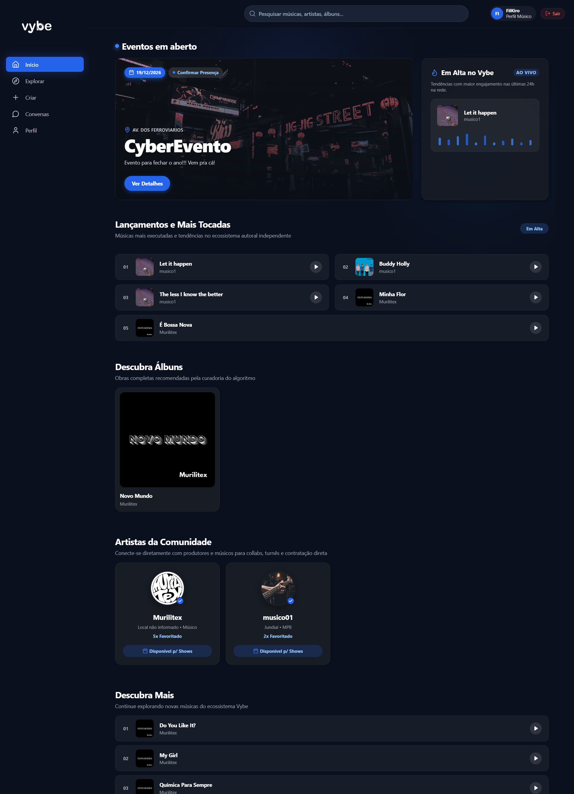
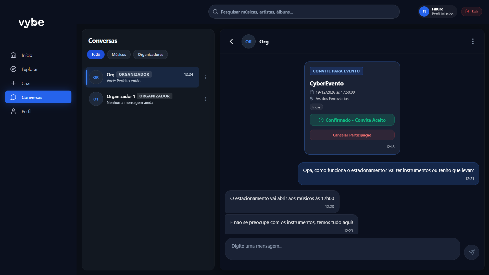
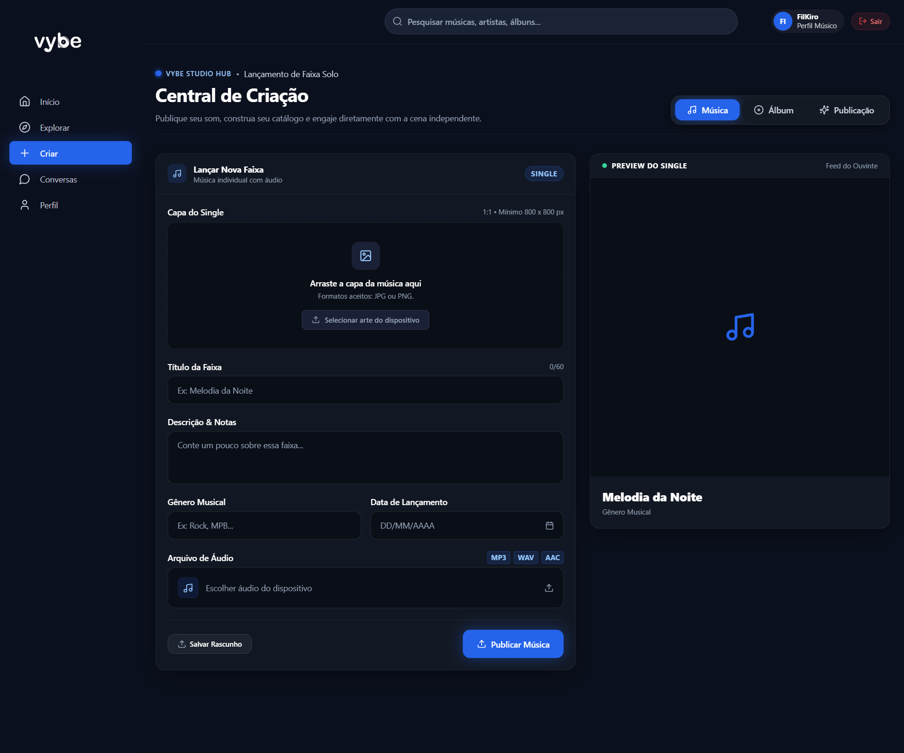

<p align="center">
  
</p>

<h1 align="center">Vybe — Plataforma Digital para Músicos Independentes</h1>

<p align="center">
  <strong>Desenvolvimento de uma plataforma digital para ajudar na divulgação de músicos independentes da região de Jundiaí</strong><br />
  Trabalho de Conclusão de Curso — Técnico em Informática para a Internet (ETEC de Campo Limpo Paulista - CPS)
</p>

<p align="center">
  <a href="https://vybe-fawn.vercel.app/" target="_blank">
    
  </a>
</p>

---

## Descrição

A **Vybe** é uma plataforma web desenvolvida para fortalecer a cena musical independente da região de Jundiaí–SP. O sistema resolve dois problemas centrais identificados na pesquisa de campo do projeto:

1. **Para músicos independentes:** a dificuldade em alcançar público, conquistar visibilidade frente a artistas já consolidados e estabelecer contato profissional com contratantes.
2. **Para organizadores de eventos:** a dificuldade de contato direto com artistas locais e a falta de informações centralizadas (portfólio, gênero musical, localização e disponibilidade) para contratação.

Em um único ambiente, a plataforma reúne perfis artísticos com portfólio de músicas e álbuns, feed da cena local, divulgação de eventos, busca com filtros/priorização de músicos e comunicação integrada por chat com envio de convites para apresentações.

---

## Acesso Online (Deploy)

A versão web da plataforma **Vybe** está hospedada e disponível para acesso diretamente pelo navegador através da **Vercel**:

- **Link da aplicação:** https://vybe-fawn.vercel.app/

---

## Equipe

- **Arthur Costa Chave** — `UI/UX`
- **Filipe Gomes dos Santos** — `Front-end/Back-end`
- **João Miguel de Campos Coimbra** — `QA/QC`

**Orientação:**
- Prof.ª Barbara Kathellen Andrade Porfirio
- Prof.ª Thaynara Cristina Maia dos Santos

---

## Tecnologias Utilizadas

| Ferramenta / Biblioteca | Versão Instalada | Finalidade no Projeto |
| --- | --- | --- |
| Node.js | `v26.13.0` | Runtime JavaScript local |
| npm | `v11.20.0` | Gerenciador de dependências |
| React | `v19.1.0` | Biblioteca base de UI |
| React Native | `v0.81.5` | Componentes nativos e primitivos visuais |
| React Native Web | `v0.21.2` | Compilação da interface para navegadores web |
| Expo | `v54.0.37` | Plataforma e ecossistema de compilação |
| Expo Router | `v6.0.24` | Roteamento nativo e URLs amigáveis |
| Supabase JS Client | `v2.112.4` (`^2.45.0`) | SDK de banco PostgreSQL, Auth e Realtime |
| Tailwind CSS | `v3.4.19` | Framework de classes utilitárias CSS |
| NativeWind | `v4.1.23` | Integração do Tailwind com React Native |
| TypeScript | `v5.9.3` | Superset tipado para o código-fonte |
| Zustand | `v4.5.7` | Gerenciamento de estado (Audio Player & Auth) |
| Lucide React Native | `v0.468.0` | Ícones da interface |
| **Vercel** | `Cloud` | Hospedagem e deploy contínuo da aplicação web |

- **Ferramentas de Apoio:** Visual Studio Code, Figma (prototipagem), Visual Paradigm (DCU) e MySQL Workbench (DER)

---

## Demonstração do Sistema

### Página Inicial (Home)

*Exibição de eventos em aberto, lançamentos em alta e artistas independentes da comunidade.*

### Conversas e Envio de Convites para Eventos

*Comunicação direta entre organizadores e músicos com envio de convites interativos e atualização em tempo real.*

### Central de Criação (Músico e Organizador)

*Publicação de faixas, álbuns, eventos e postagens no Feed da Cena com pré-visualização em tempo real.*

---

## Estrutura do Projeto

Os arquivos de documentação, modelagem, design e banco de dados do TCC estão organizados nos seguintes diretórios principais:

```text
Vybe/
├── docs/        # Documentação do TCC (questionário, fichamento, relatórios, etc.)
├── design/      # Protótipos, diagramas, identidade visual e capturas de tela
└── database/    # Scripts SQL (tabelas, enums, políticas de RLS) e modelos de dados
```

- **`/docs`** — Reúne toda a documentação acadêmica e de pesquisa do TCC, incluindo o questionário aplicado à pesquisa de campo, fichamentos bibliográficos, levantamentos de requisitos e demais materiais escritos de apoio.
- **`/design`** — Centraliza os artefatos visuais e de modelagem da interface e do sistema, como o protótipo de média fidelidade (Figma), Diagrama de Casos de Uso (DCU), Diagrama Entidade-Relacionamento (DER), identidade visual (logotipo e paleta) e as capturas de tela da aplicação desenvolvida.
- **`/database`** — Contém os scripts SQL de estruturação do banco de dados no Supabase (criação de `ENUM`s, tabelas, chaves estrangeiras e políticas de segurança *Row Level Security — RLS*), além dos modelos de dados utilizados para replicar o ambiente.

---
## Como Executar o Projeto (Passo a Passo)

### Pré-requisitos

[Node.js](https://nodejs.org/) instalado (`v18+` recomendado)

[Git](https://git-scm.com/) instalado

Uma conta e projeto configurados no [Supabase](https://supabase.com/)

### 1. Clone o repositório

```bash
git clone https://github.com/Filkiro/Vybe.git
cd Vybe
```

### 2. Instale as dependências

```bash
npm install
```

### 3. Configure as variáveis de ambiente

Renomeie o arquivo `.env.exemple` na raiz do projeto para `.env` (removendo somente o `.exemple`) e insira as credenciais do seu projeto Supabase:

```env
EXPO_PUBLIC_SUPABASE_URL=[URL_DO_SUPABASE_PUBLICA]
EXPO_PUBLIC_SUPABASE_ANON_KEY=[ANON_KEY_DO_SUPABASE]
```

### 4. Execute o servidor de desenvolvimento

```bash
npx expo start -w

```

### 5. Acesse no navegador
Abra o endereço exibido no terminal (geralmente `http://localhost:8081`).

---

## Como Citar o Projeto

```text
CHAVE, Arthur Costa; SANTOS, Filipe Gomes dos; COIMBRA, João Miguel de Campos. Desenvolvimento de uma plataforma digital para ajudar na divulgação de músicos independentes da região de Jundiaí. 2026. 63 p. Trabalho de Conclusão de Curso (Técnico em Informática para a Internet) – ETEC de Campo Limpo Paulista, Centro Paula Souza, Campo Limpo Paulista, 2026.
```

---


## Contato e Documentação

Em caso de dúvidas sobre o projeto, entre em contato com a equipe:

**Arthur Costa Chave:** arthur.chave@aluno.cps.sp.gov.br
**Filipe Gomes dos Santos:** gomeslipeff8888@gmail.com
**João Miguel de Campos Coimbra:** joao.coimbra2@aluno.cps.sp.gov.br


Para acessar o trabalho escrito do projeto no Repositório Institucional do Conhecimento do Centro Paula Souza:

**RIC-CPS:** https://ric.cps.sp.gov.br/
